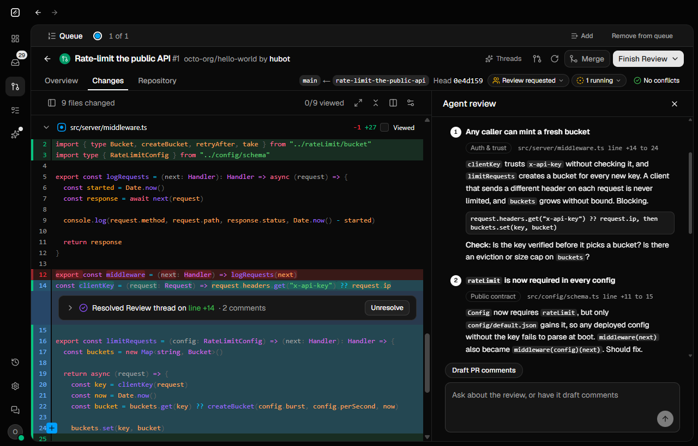

# Glass

**Review code at the speed agents write it.**

Agents now write more code than anyone can read line by line. Glass is a desktop app that puts
your pull requests and your coding agents in one place, and helps you spend your attention where
it counts.



- **Know where to look.** An Agent review ranks the few Hotspots worth your closest read and
  marks the files you can skim. It stays on your machine, never posts to GitHub, and never
  approves anything for you.
- **Read a PR in the right order.** A Tour explains why the change exists, draws it as a diagram
  or a Before / after, then walks you through it from the part that matters most to the glue.
- **Ask, don't guess.** Ask about any line of the diff and get a private answer beside it. Keep
  the agent's suggested comments you agree with, and post them as your own GitHub review.
- **Run agents without losing track.** Start Claude Code or pi in Threads, each in its own
  worktree or Sandbox. Glass names the branch, links the PR, and brings their questions and
  permission requests to you.
- **One Inbox for everything waiting on you.** Reviews, agent questions, permission requests, and
  Check-ins from agents running in your terminal ([outside agents](docs/user/outside-agents.md)),
  grouped by why they wait.

## Layout

| Path                 | What it is                                                                     |
| -------------------- | ------------------------------------------------------------------------------ |
| `apps/desktop`       | Electron app: main, preload, and React renderer, built separately.             |
| `apps/server`        | Effect backend: RPC over WebSocket on `127.0.0.1`, behind a per-launch secret. |
| `packages/contracts` | Effect Schema RPC definitions and errors shared by every app.                  |
| `packages/plugin`    | The types a Plugin implements to add a kind of Sandbox (ADR 0011).             |
| `examples`           | A fake Sandbox provider Plugin and a prompt for writing your own.              |
| `tools/oxlint`       | Lint rules `pnpm check` runs, including Glass's import and test-wait policies. |

## Requirements

Node 24.11+ and pnpm 11, pinned in [`mise.toml`](mise.toml): run `mise install`.

Tooling is [Vite+](https://viteplus.dev) (`vp`), configured in each package's `vite.config.ts`.

Glass signs in to GitHub with `GH_TOKEN`, `GITHUB_TOKEN`, or your GitHub CLI login (`gh auth login`).

Tours, Agent reviews, and Threads use either an authenticated Claude Code CLI or an installed pi CLI.
If Glass can't find them on your `PATH`, set `claudeCommand` or `piCommand` in `~/.project-glass/settings.json` to the full path and restart Glass.
pi reuses the credentials and model configuration in `~/.pi/agent` (or `PI_CODING_AGENT_DIR`).

## Commands

```sh
mise install         # Node and pnpm at the pinned versions
pnpm install
pnpm dev             # Vite + watch builds + Electron, restarted on main/preload/backend changes
pnpm dev:fake        # pnpm dev on a fake GitHub with demo PRs and model-free Tours, in fresh data
pnpm start           # build everything and run the app as it ships
pnpm dist            # package an installer into apps/desktop/release
pnpm test            # backend, renderer, and verification helper tests, at once on half the cores each
pnpm test:e2e        # build, then drive the Electron app with Playwright
pnpm gallery:capture # build, then screenshot every app state on the demo data into .gallery/index.html
pnpm gallery:show    # open the last gallery in your browser
pnpm check           # format check, type-aware lint, and type check
pnpm fix             # apply format and lint fixes
```

The backend runs on its own: `GLASS_PORT=4000 GLASS_TOKEN=secret node apps/server/dist/bin.mjs`.

To profile the backend, set the standard `OTEL_*` variables before `pnpm dev` and it also sends
every span and log line over OTLP/HTTP, e.g. to the Aspire dashboard:

```sh
docker run --rm -p 18888:18888 -p 4318:18890 -e DOTNET_DASHBOARD_UNSECURED_ALLOW_ANONYMOUS=true \
  mcr.microsoft.com/dotnet/aspire-dashboard:9.5
export OTEL_TRACES_EXPORTER=otlp OTEL_LOGS_EXPORTER=otlp OTEL_EXPORTER_OTLP_ENDPOINT=http://localhost:4318
pnpm dev   # traces and logs at http://localhost:18888
```

## Storage

The backend keeps the Activity log in `~/.project-glass/glass.db`.

## Docs

- [`GLOSSARY.md`](GLOSSARY.md): the domain words Glass uses in code, UI copy, and specs.
- [`docs/adr`](docs/adr): architecture decisions.
- [`docs/architecture/agent-threads.md`](docs/architecture/agent-threads.md): how Threads run.

The screenshots come from `pnpm gallery:capture` on the demo data.
