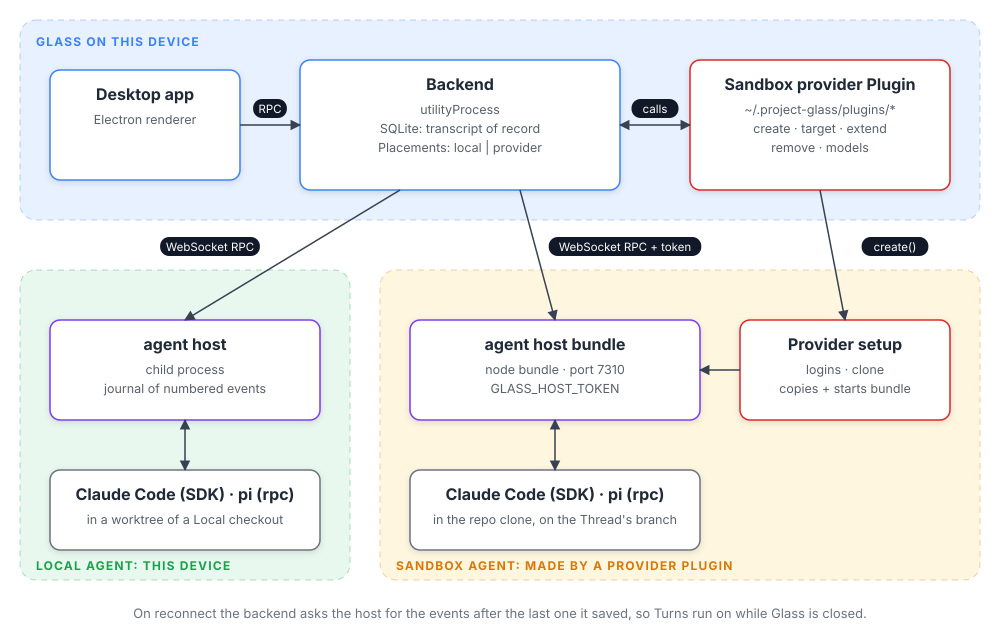
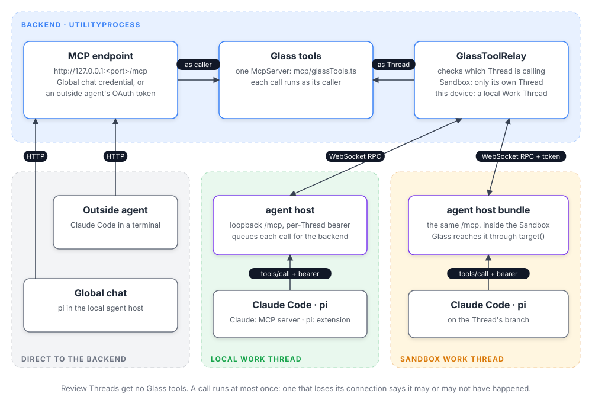
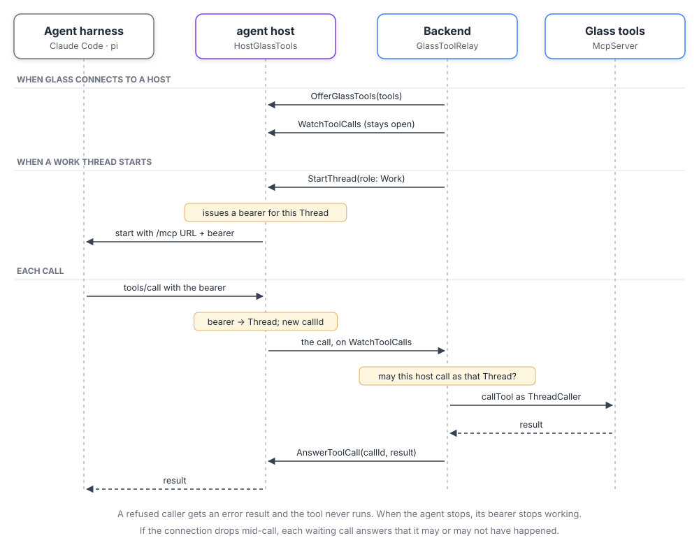
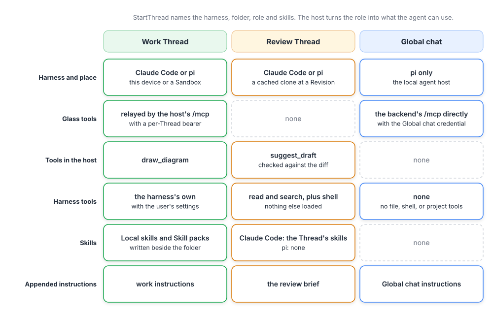

# How Threads run

Every Thread runs in an agent host. The host is a small Node server built from Glass's own code. It drives Claude Code
or pi, keeps a journal of numbered events, and serves Effect RPC over WebSocket. The backend keeps the transcript of record.

## Where the host runs

The host ships as one self-contained bundle. For local Threads, the backend spawns the bundle detached
and records its port, token and fingerprint in `agent-host.json` in the data directory. On the next launch,
Glass reattaches to a host with the same fingerprint (ADR 0016). For a Sandbox Thread, Glass hands the
provider's `create` the bundle's path, port 7310, and an environment carrying `GLASS_HOST_TOKEN`. The provider
copies the bundle into the Sandbox and starts it (ADR 0011). From then on, local and Sandbox Threads differ only in where their
host runs (ADR 0007).

## When a host is gone or outdated

A local host rereads its record every `RECORD_CHECK_INTERVAL` and stops if the record is gone or
names another host while no backend follows its journal. At launch, a host that refuses the
connection is gone; one slow to answer is busy with its Turns, not dead. The host writes its logs
to the backend log file itself, because a pipe through the backend would break once the backend
quits.

When a Sandbox's host speaks another protocol, Glass saves that a replacement is under way before
it ends the old host, so one that fails part-way is tried again, even after a relaunch. Calls to a
provider stay bounded: Glass stops retrying a Sandbox it can't reach until the user or a relaunch
starts over (ADR 0012).

## How agents reach Glass's tools

The backend defines Glass's tools once. It answers them on two paths:

- **Directly**: the backend's own MCP endpoint serves the Global chat, with a credential of its own,
  and Outside agents, with an OAuth token.
- **Through the host**: every Work Thread calls the MCP endpoint its host serves on loopback. The
  host defines no tools of its own there. It forwards each call over the WebSocket connection Glass
  already holds to it, so a Sandbox opens no new way into this device (ADR 0015).

## One relayed call

The backend never takes the host's word for which Thread is calling. A call on a Sandbox host's
connection may act only as that Sandbox's Thread. A call on the local host's connection must name a local Work
Thread.

## What each kind of Thread gets

`StartThread` names the harness, folder, role and skills. The host writes Local skills and Skill
packs into a folder beside the Thread's folder. Claude Code loads them as plugins, and pi loads them with
`--skill`. Tools that need nothing from the backend, `draw_diagram` and `suggest_draft`, are
defined in the host and answered there. Every agent asks the user with the Glass tool `ask_user`,
which returns at once; the answer comes back later as a message.
