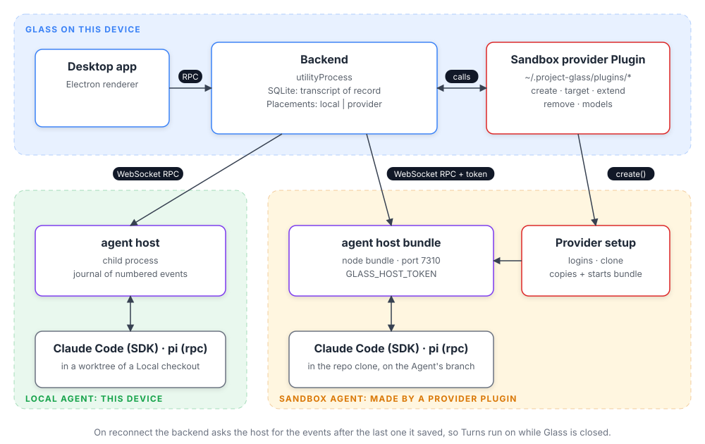

# @glass/plugin

The types a Plugin implements to add a kind of Sandbox to Glass (ADR 0010). The contract lives in
[`src/index.ts`](src/index.ts) and uses Promises and `AbortSignal`, so a Plugin needs no Effect.

Every Agent runs in an agent host: a small Node server, built from Glass's own code, that drives
Claude Code or pi, keeps a journal of numbered events, and serves RPC over WebSocket (ADR 0007).
Local Agents start it as a child process. For a Sandbox Agent, the provider's `create` makes the
Sandbox, sets up logins, clones the repository, and copies in and starts the host bundle Glass hands
it, with the token, port, and address in its environment. Glass then reaches the host through
`target` and keeps the transcript in SQLite, resuming from the last saved event after a dropped
connection.

To write one, start from [`examples/fake-sandboxes`](../../examples/fake-sandboxes) or paste
[`examples/sandbox-provider-prompt.md`](../../examples/sandbox-provider-prompt.md) into your coding
agent. The diagram's source is [`docs/diagrams/agent-host.html`](../../docs/diagrams/agent-host.html);
re-export it with its SVG button after changing it.
